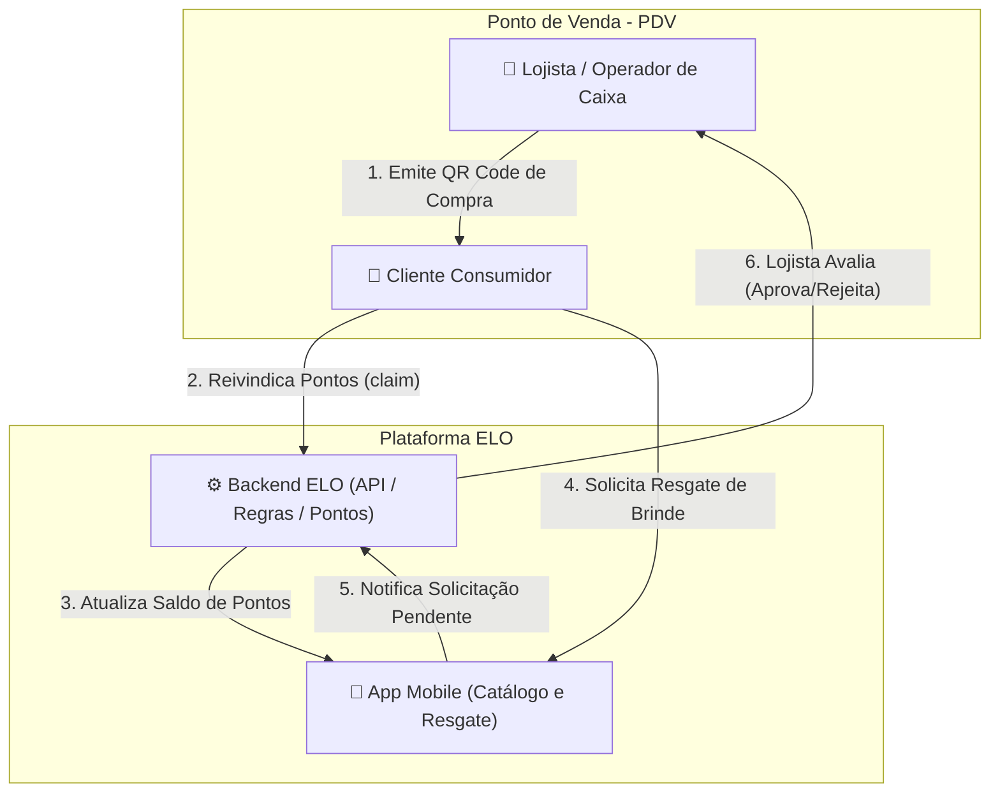
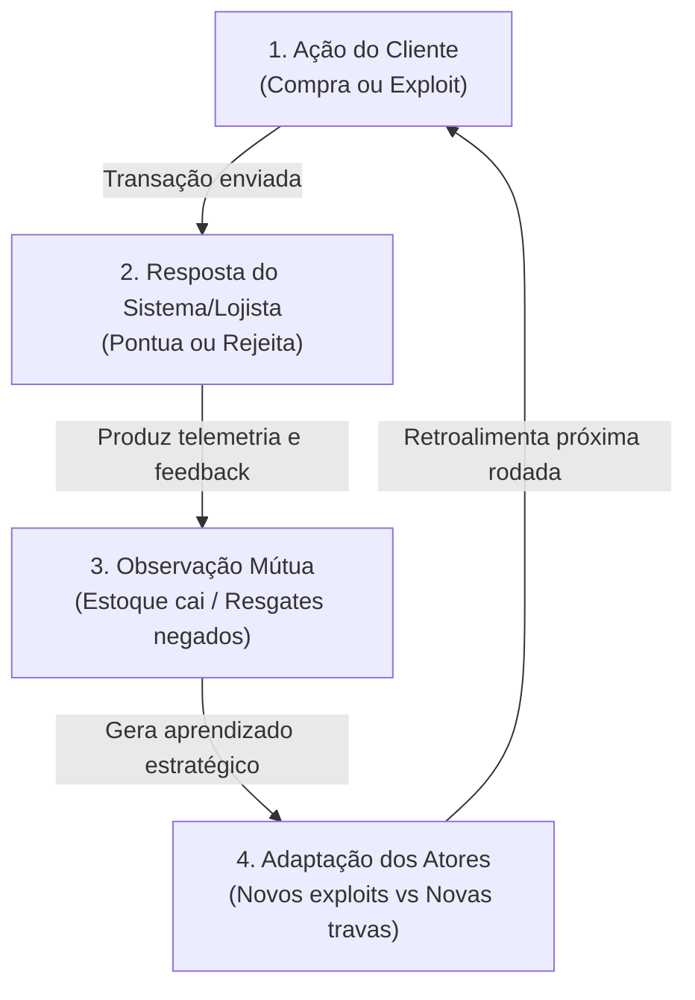
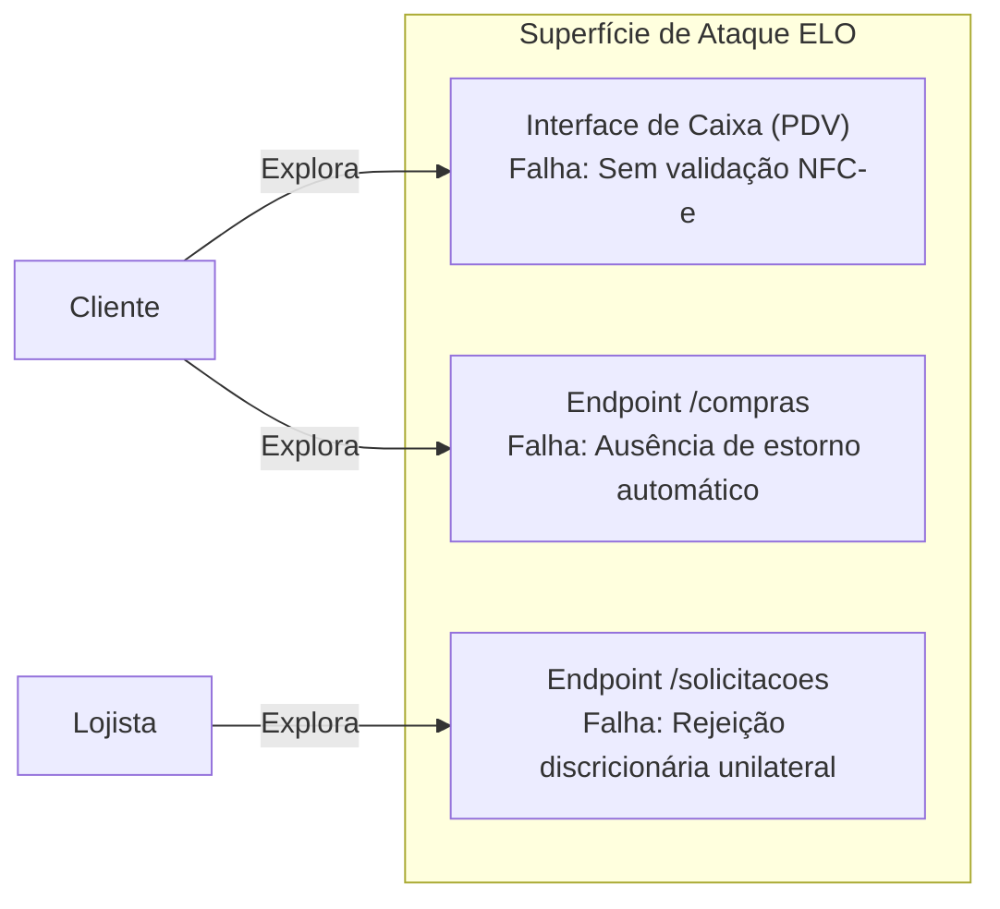

# Trabalho 1 - Análise de um Sistema Adversarial: Plataforma ELO

**Instituição:** UNIPAMPA - Universidade Federal do Pampa  
**Disciplina:** Engenharia de Software Adversarial  
**Docentes:** Prof. Paulo Silas Severo de Souza e Prof. Silvio Ereno Quincozes  
**Projeto:** Sistema ELO / Indiki (Fidelidade e Premiação do Comércio Local)  
**App em Produção (Google Play):** [Cardial ELO / Indiki](https://play.google.com/store/apps/details?id=com.cardialit.indiki&hl=pt_BR)  
**Repositório Base:** `Cardial/back-elo`, `Cardial/elo-app`, `Cardial/elo-web`  
**Vídeo da Apresentação (YouTube):** [https://youtu.be/-KVf88s-INQ](https://youtu.be/-KVf88s-INQ)  
**Apresentação em Slides (PDF):** [Apresentacao_Adversarial_ELO.pdf](./Apresentacao_Adversarial_ELO.pdf)

---

## 1. Proposta e Delimitação da Interação

### 1.1 Sistema e Interação Escolhida
O sistema escolhido para a análise é o **ELO**, uma plataforma de recompensas e fidelização voltada ao comércio varejista local.
Em conformidade com a exigência de não analisar um domínio genérico, este trabalho delimita e analisa uma **interação específica e central**:
> **Interação Analisada:** O ciclo de **Concessão de Pontos/Cupons no Caixa (PDV)** e a posterior **Solicitação e Validação de Resgate de Recompensas no Aplicativo Mobile**.

### 1.2 Por que o caso representa uma situação adversarial?
A situação **não é um erro ou mero acidente de software**, mas sim um cenário estritamente **adversarial** porque os dois participantes são **agentes racionais dotados de objetivos conflitantes** e operam com assimetria de informação. Ambos tomam decisões estratégicas para maximizar seu próprio ganho explorando as regras de negócio do sistema:
* O cliente busca ativamente brechas operacionais (como devolução de itens mantendo pontos ou esgotamento rápido de brindes em compras únicas) para extrair valor máximo com gasto mínimo.
* O comerciante reage defensivamente, podendo alterar regras unilateralmente ou rejeitar solicitações válidas para estancar perdas financeiras.

---

## 2. Descrição do Sistema Adversarial (Seção 3.1)

### 2.1 Atores e Propriedades a Preservar
* **Ativos Críticos:** 
  1. *Distribuição Correta de Recursos:* Preservação do estoque de recompensas e da saúde financeira do lojista contra extrações indevidas.
  2. *Confiança na Moeda de Troca:* Garantia de que pontos honestamente conquistados serão convertidos em prêmios reais sem arbitrariedades.

### 2.2 Tabela de Atores do Ecossistema

| Ator | Objetivo Principal | Ações ou Capacidades | Informações Observáveis | Restrições ou Custos |
| :--- | :--- | :--- | :--- | :--- |
| **Cliente ($C$)** | Maximizar resgates de brindes e benefícios desembolsando o menor valor financeiro real. | Realizar compras, escanear QR Code de pontos, acumular saldo e solicitar resgates de prêmios no app. | Saldo de pontos, catálogo e estoque visível de brindes no app, regras ativas de pontuação. | Gasto financeiro real, tempo gasto na compra e risco de ter o resgate rejeitado pelo lojista. |
| **Lojista ($L$)** | Maximizar retenção de clientes e faturamento, minimizando o custo operacional de prêmios. | Gerar QR Code de pontuação no caixa, cadastrar campanhas e regras, aprovar ou rejeitar resgates no painel (`PUT /solicitacoes`). | Histórico de compras do cliente, solicitações de resgate pendentes, estoque físico disponível. | Custo financeiro do brinde entregue, tempo de atendimento no caixa, risco de perda de reputação. |

### 2.3 Diagrama de Contexto Simples



### 2.4 Pressupostos Centrais do Sistema e suas Falhas
1. **Pressuposto 1 (Permanência da Compra):** O sistema assume que a compra que gerou a pontuação é definitiva e irrevogável.
   * *Como falha:* O cliente realiza uma compra cara, ganha os pontos, resgata o brinde no app e depois vai à loja física solicitar a devolução da mercadoria pelo Código de Defesa do Consumidor. Como o ELO não está integrado ao ERP fiscal da loja, o lojista devolve o dinheiro no caixa físico mas o sistema ELO não estorna os pontos nem cancela o brinde já emitido (*The Return Scam*).
2. **Pressuposto 2 (Cumprimento da Oferta pelo Lojista):** O sistema assume que o comerciante sempre entregará a recompensa prometida caso o consumidor atinja os pontos exigidos.
   * *Como falha:* O lojista cadastra um brinde atraente apenas para atrair clientes. Quando os consumidores chegam à pontuação exigida, o lojista usa seu poder discricionário na rota `PUT /solicitacoes/processar/:id` com status `rejeitada`, alegando falta de estoque para evitar o custo do prêmio (*Brinde Isca / Bait & Switch*).

---

## 3. Modelo Estratégico Estático (Seção 3.2)

Modelemos a decisão central como um jogo estático de informação completa com 2 jogadores e 2 ações disponíveis para cada um.

### 3.1 Espaço de Ações
* **Jogador A (Cliente):**
  * **A₁ (Cliente Honesto / Íntegro):** Realiza compras normais e resgata brindes de forma proporcional à sua fidelidade real.
  * **A₂ (Cliente Oportunista / Golpe da Devolução):** Explora brechas operacionais (devolução sem estorno ou corrida para drenar o catálogo de brindes sem fidelização).
* **Jogador B (Lojista):**
  * **B₁ (Lojista Flexível / Baixo Atrito):** Gera pontuação ágil no caixa e aprova solicitações no aplicativo sem barreiras burocráticas.
  * **B₂ (Lojista Defensivo / Rigoroso):** Impõe checagens manuais, atrasa aprovações e rejeita solicitações suspeitas no aplicativo.

### 3.2 Matriz de Payoffs (Ordem de Preferência de 0 a 3)
A ordem de preferência de cada participante é calibrada na escala de **3 (Melhor resultado possível)**, **2 (Bom)**, **1 (Ruim)** e **0 (Pior resultado possível)**.  
O par de payoffs é dado por: `(Payoff do Cliente, Payoff do Lojista)`.

| Jogador A (Cliente) \ Jogador B (Lojista) | B₁: Lojista Flexível (Confiante / Ágil) | B₂: Lojista Defensivo (Desconfiado / Rigoroso) |
| :--- | :---: | :---: |
| **A₁: Cliente Honesto** | **(2, 3)** | **(1, 1)** |
| **A₂: Cliente Malandro (Golpe da Devolução)** | **(3, 0)** | **(0, 2)** |

### 3.3 Justificativa dos Payoffs e Análise Estratégica
* **Resultado (A₁, B₁) = (2, 3):** O lojista atinge seu melhor cenário (3), pois fidelizou o cliente e manteve atendimento rápido no PDV. O cliente tem um bom ganho (2), pois pontuou e resgatou seu brinde de forma fluida.
* **Resultado (A₂, B₁) = (3, 0):** O cliente oportunista atinge sua utilidade máxima (3), obtendo recompensas sem contrapartida de lucro para a loja. O lojista tem seu pior resultado (0), arcando com prejuízo de estoque.
* **Resultado (A₁, B₂) = (1, 1):** O lojista burocratiza o processo e desconfia; o cliente honesto se frustra com a demora (1) e o lojista gasta tempo de atendimento arriscando perder o cliente (1).
* **Resultado (A₂, B₂) = (0, 2):** A tentativa de exploração do cliente é frustrada e ele tem payoff zero (0). O lojista preserva seu estoque (2), embora tenha arcado com o custo operacional do atrito.

### 3.4 Melhores Respostas e Equilíbrio de Nash
* Se o Lojista for **Flexível (B₁)**: O Cliente compara A₁ (payoff 2) com A₂ (payoff 3). A melhor resposta do Cliente é jogar **Oportunista (A₂)**, pois nota 3 > 2.
* Se o Lojista for **Defensivo (B₂)**: O Cliente compara A₁ (payoff 1) com A₂ (payoff 0). A melhor resposta do Cliente é jogar **Honesto (A₁)**, pois nota 1 > 0.
* Se o Cliente for **Honesto (A₁)**: O Lojista compara B₁ (payoff 3) com B₂ (payoff 1). A melhor resposta do Lojista é jogar **Flexível (B₁)**, pois nota 3 > 1.
* Se o Cliente for **Oportunista (A₂)**: O Lojista compara B₁ (payoff 0) com B₂ (payoff 2). A melhor resposta do Lojista é jogar **Defensivo (B₂)**, pois nota 2 > 0.

> [!IMPORTANT]
> **Conclusão:** **Não existe estratégia dominante** para nenhum dos dois jogadores e **não há Equilíbrio de Nash em estratégias puras**. O sistema é inerentemente instável: a facilidade atrai a exploração; a exploração força a defesa; a defesa sufoca o cliente honesto; a busca por clientes honestos força a reabertura de facilidades.

---

## 4. Modelo Estratégico Dinâmico (Seção 3.3)

### 4.1 Tabela de Rodadas do Ciclo Adaptativo
Transformando a análise em um processo temporal em três rodadas sucessivas (Ação $\rightarrow$ Resposta $\rightarrow$ Observação $\rightarrow$ Adaptação):

| Rodada | Ação do Participante (Cliente) | Resposta do Sistema ou Defensor (Lojista) | O que se torna Observável? | Adaptação para a Rodada Seguinte |
| :---: | :--- | :--- | :--- | :--- |
| **1** | Realiza compras habituais e resgata brindes de forma honesta. | Lojista pontua no PDV com agilidade e aprova o resgate no painel web. | O cliente observa que o sistema não audita a retenção fiscal pós-compra. | O cliente percebe a viabilidade de resgatar prêmios caros usando compras passíveis de troca/devolução. |
| **2** | **Ataque Return Scam:** Compra item caro (R$ 300), resgata o brinde no app e devolve o item no balcão físico. | Loja devolve o dinheiro no caixa físico mas não possui integração de estorno no ELO. | O lojista percebe o estoque de brindes drenado sem incremento no balanço de vendas. | O lojista adota postura punitiva, passando a recusar arbitrariamente solicitações de alto valor no app. |
| **3** | Cliente tenta novo resgate; clientes honestos também solicitam seus prêmios legítimos. | Lojista clica em `decisao: 'rejeitada'` indiscriminadamente para estancar o prejuízo. | Clientes honestos observam que a recompensa prometida virou "propaganda enganosa". | **Corrida Armamentista:** Clientes legítimos abandonam o app; o sistema exige redesenho arquitetural. |

### 4.2 Diagrama do Ciclo Adaptativo



### 4.3 Propriedades do Modelo Dinâmico
1. **Quem observa quem?** O cliente observa a taxa de aprovação, prazos de entrega e estoque disponível no app. O lojista observa o saldo de pontos concedidos, a frequência de compras e a lista de solicitações pendentes no dashboard.
2. **O que cada lado consegue mudar?** O cliente consegue mudar seu padrão de compra (concentrar compras familiares em uma conta, fazer compras pontuais elevadas para resgate imediato ou explorar devoluções). O lojista consegue alterar a pontuação exigida por brinde ou rejeitar resgates no sistema.
3. **O que dispara uma adaptação?** Perda financeira tangível percebida pelo lojista (estoque zerado sem lucro) ou quebra de expectativa percebida pelo cliente (brinde honesto rejeitado).
4. **Qual é o custo da adaptação para cada lado?** Para o lojista: perda de tempo investigando clientes e desgaste da reputação do comércio. Para o cliente: pontos retidos sem retorno e atrito no atendimento.
5. **Em que ponto surge a corrida armamentista?** Quando o lojista tenta se defender punindo manualmente todos os resgates, fazendo com que clientes desenvolvam técnicas mais sofisticadas (como uso de múltiplas contas familiares) para contornar os bloqueios.

---

## 5. Ameaças e Riscos (Seção 3.4)

### 5.1 Diagrama de Superfície de Ataque



### 5.2 Matriz e Cenários de Ameaça (Escala de 1 a 3)
* **Probabilidade:** 1 = Baixa, 2 = Média, 3 = Alta
* **Impacto:** 1 = Baixo, 2 = Médio, 3 = Alto
* **Risco:** Probabilidade $\times$ Impacto (1 a 9)

| ID | Cenário de Ameaça (Formato da Norma) | Ponto de Exploração | Pressuposto ou Fraqueza | Ativo Afetado | Prob. | Imp. | Risco |
| :---: | :--- | :--- | :--- | :--- | :---: | :---: | :---: |
| **A1** | Um **cliente** pode realizar **devolução de mercadoria no caixa mantendo pontos** por meio do **fluxo de pós-venda desintegrado**, aproveitando a **ausência de webhook de estorno fiscal**, causando **prejuízo financeiro e esgotamento de prêmios** sobre a **margem e estoque do lojista**. | Fluxo físico de devoluções no balcão | Desconexão entre ERP físico e banco de dados do ELO | Estoque e Margem do Lojista | 3 | 3 | **9 (Crítico)** |
| **A2** | Um **cliente** pode realizar **esgotamento predatório de brindes em compra única (Hit-and-Run)** por meio de **uma única transação atípica de alto valor**, aproveitando a **ausência de requisito de recorrência de visitas no resgate**, causando **drenagem rápida do catálogo de prêmios sem gerar fidelização real** sobre o **estoque e margem do lojista**. | Regras de validação de resgate em `recompensasController.js` | Resgate liberado puramente por saldo sem histórico de frequência | Estoque de Prêmios e Retenção do Lojista | 3 | 2 | **6 (Médio)** |
| **A3** | Um **lojista** pode realizar **rejeição arbitrária de recompensas alcançadas** por meio do endpoint `PUT /solicitacoes/processar/:id`, aproveitando o **poder discricionário unilateral sem auditoria**, causando **perda de incentivo e evasão** sobre a **confiança na moeda de fidelidade**. | Rota `processarSolicitacao` no backend | Falta de bloqueio automático de estoque e aprovação programática | Confiança no Ecossistema ELO | 2 | 3 | **6 (Médio)** |

---

### 5.3 Aprofundamento na Ameaça Prioritária (A1 - Risco 9)
* **Como o sistema poderia responder:** Implementando um módulo de **Custódia Temporária (Escrow de Pontos)**: transações de compras de alto valor concedem pontos em status `pendente` durante o período legal de garantia/devolução (ex: 7 dias) antes de se tornarem utilizáveis para resgate.
* **Que informação essa resposta revelaria:** Revela ao adversário que compras de alto valor estão sob monitoramento temporal, informando exatamente a regra do gatilho de carência.
* **Como o adversário se adaptaria:** O adversário tentará pulverizar transações em valores imediatamente abaixo do teto de custódia (*Smurfing de transações*) ou buscará lojas conveniadas que vendam produtos de consumo imediato sem direito a arrependimento.
* **Efeitos colaterais em usuários legítimos:** Usuários honestos perdem a gratificação instantânea da compra, precisando aguardar a liberação do saldo para usufruir de brindes.
* **Risco residual existente:** O risco de conluio entre cliente e operador do caixa físico para simular transações falsas no sistema.
* **O que o sistema precisa continuar preservando:** A atratividade do programa de fidelidade e a agilidade nas compras normais de baixo valor do dia a dia.

---

## 6. Resposta à Pergunta Final (Seção 7)

> **Pergunta:** *"Depois que o sistema responder, o que o outro lado aprenderá e tentará fazer em seguida?"*

**Resposta:**  
Após o sistema implementar regras defensivas (como prazos de custódia de pontos e exigência de recorrência mínima para resgate), o adversário aprenderá que **resgates imediatos a partir de transações únicas isoladas são bloqueados**.  
Em seguida, ele tentará **migrar para a consolidação familiar**: criará ou integrará contas de múltiplos parentes para somar pequenos saldos de compras legítimas rotineiras, ou buscará estabelecimentos parceiros menores que não fiscalizem a identidade do recebedor do brinde no momento da retirada física.

---

## 7. Entregáveis e Estrutura Arquitetural p/ o Trabalho 2

Para dar suporte e continuidade direta à implementação no **Trabalho 2**, a estrutura do repositório Git seguirá a norma:

```text
trabalho-adversarial/
├── README.md                          <- Este relatório analítico completo
├── diagramas/
│   ├── contexto.png                   <- Diagrama de contexto (Cliente, Lojista, ELO)
│   ├── superficie-de-ataque.png       <- Mapeamento dos endpoints e pontos de falha
│   └── ciclo-adaptativo.png           <- Diagrama das rodadas e ciclo adaptativo
└── fontes/
    └── referencias.md                 <- Documentação e referências teóricas
```

### 7.1 Declaração de Uso de IA Generativa (Seção 6)
* **Ferramenta Utilizada:** Google Gemini / Antigravity Assistant.
* **Finalidade do Uso:** Auxílio na estruturação textual do relatório em Markdown, sintetização da matriz matemática de Teoria dos Jogos e geração de estilos visuais da apresentação.
* **Validação Humana:** Todas as vulnerabilidades de regras de negócio, dados dos controladores (`comprasController`, `solicitacoesController`), modelos do Sequelize e fluxos reais do aplicativo ELO foram integralmente auditados, revisados e validados pelos integrantes do grupo acadêmico com base no código-fonte oficial.
